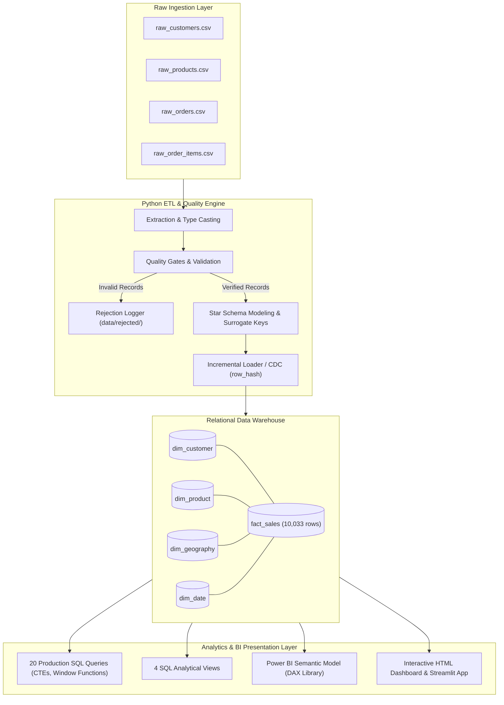
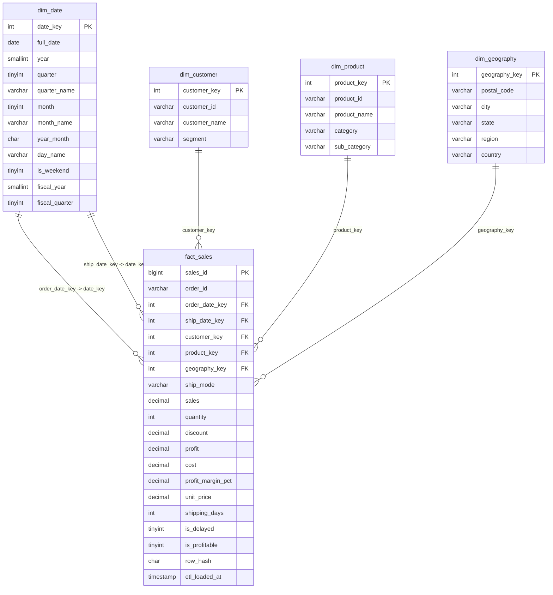

# End-to-End Retail Sales Data Engineering & BI Analytics Platform

[](https://www.python.org/)
[](https://pandas.pydata.org/)
[]()
[](https://www.mysql.com/)
[](https://www.sqlite.org/)
[](https://powerbi.microsoft.com/)
[](https://plotly.com/)

An enterprise-grade, end-to-end data analytics platform that ingests raw retail sales transactions, applies automated quality gates and transformation pipelines, models a Star Schema relational data warehouse, executes 20 production SQL analytical queries, and powers an executive 4-page Business Intelligence dashboard suite.

---

## Architecture Overview



---

## Dimensional Data Model (Star Schema)

The data warehouse uses a conformed **Star Schema** optimized for high-performance aggregation and Power BI DirectQuery/Import modes:



---

## Directory Structure

```text
d:\power BI Project\
├── data/
│   ├── raw/                           # Raw multi-source CSV files
│   │   ├── raw_customers.csv
│   │   ├── raw_products.csv
│   │   ├── raw_geography.csv
│   │   ├── raw_orders.csv
│   │   ├── raw_order_items.csv
│   │   └── sample_superstore.csv      # Real-world benchmark dataset
│   ├── processed/                     # Conformed clean CSV & Parquet files (Power BI ready)
│   │   ├── dim_customer.csv
│   │   ├── dim_product.csv
│   │   ├── dim_geography.csv
│   │   ├── dim_date.csv
│   │   └── fact_sales.csv
│   └── rejected/                      # Audit trail of rejected records with reason codes
│       ├── customers_rejected.csv
│       ├── products_rejected.csv
│       ├── orders_rejected.csv
│       └── order_items_rejected.csv
├── src/
│   ├── config.py                      # Database URLs, paths, thresholds
│   ├── generate_sources.py            # Generates modular sources with dirty test cases
│   ├── quality_checks.py              # Automated validation gates & assertion rules
│   ├── transform.py                   # Star schema modeling & metric engineering
│   ├── load.py                        # Database loader & index creator
│   ├── pipeline.py                    # Master CLI orchestrator with structured logging
│   ├── run_sql_analytics.py           # Test runner verifying all 20 SQL queries
│   ├── build_interactive_dashboard.py # Standalone interactive HTML visual dashboard builder
│   └── streamlit_app.py               # Live interactive web application
├── sql/
│   ├── 01_mysql_schema_ddl.sql        # Production MySQL DDL (FKs, indexes, stored procedure)
│   ├── 02_reporting_views.sql         # 4 core reporting views
│   └── 03_advanced_analytics_20.sql   # 20 advanced analytical SQL queries
├── powerbi/
│   ├── dax_measures.dax               # Complete library of enterprise DAX formulas
│   ├── dashboard_guide.md             # 4-page visual wireframe & design specification
│   └── interactive_dashboard.html     # Instant browser-viewable 4-page dashboard
├── logs/
│   └── etl_pipeline.log               # Execution logs with timestamps and row counts
├── retail_sales_dw.db                 # Deployed local SQLite relational warehouse
├── requirements.txt                   # Project dependencies
└── README.md                          # Project documentation
```

---

## Data Quality & Validation Engine

The pipeline enforces production-grade data quality checks before any record touches the warehouse. Any malformed record is automatically quarantined to `data/rejected/` with a timestamp and rejection reason:

| Rule Category | Check Performed | Failure Action |
|---|---|---|
| **Primary Keys** | Null or empty IDs (`customer_id`, `product_id`, `order_id`) | Quarantined to `_rejected.csv` (`NULL_OR_EMPTY_KEY`) |
| **Uniqueness** | Duplicate Primary Key checks | Deduplicated, duplicates logged (`DUPLICATE_KEY`) |
| **Date Integrity** | Invalid date formats, `ship_date < order_date` logic checks | Quarantined (`INVALID_DATE_FORMAT`, `SHIP_DATE_BEFORE_ORDER_DATE`) |
| **Numeric Constraints** | `sales <= 0`, `quantity <= 0`, `discount < 0 OR > 1.0` | Quarantined (`OUT_OF_BOUNDS_FINANCIAL_METRIC`) |
| **Referential Integrity** | Orders without customers, items without products/orders | Quarantined (`ORPHAN_CUSTOMER_ID_FK_VIOLATION`) |
| **Pipeline Quality Gate** | Rejection rate assertion | Raises warning if rejection rate exceeds 5.0% |

---

## 20 Advanced SQL Analytical Queries

All 20 queries are written and verified with 100% success in `sql/03_advanced_analytics_20.sql`:

| # | Business Question / Analytical Objective | SQL Technique Used |
|---|---|---|
| **1** | Yearly & Quarterly Revenue, Cost, Profit & Margin | Aggregations, Group By, Fiscal Quarters |
| **2** | Month-over-Month (MoM) Revenue Growth Rate | Window Function `LAG() OVER (...)` |
| **3** | Cumulative Running Total Sales by Year | Window Function `SUM() OVER (PARTITION BY ...)` |
| **4** | Top 10 Best-Selling Products by Gross Revenue | Window Function `DENSE_RANK() OVER (...)` |
| **5** | Top 5 Most Profitable vs Top 5 Loss-Making Products | CTEs, `UNION ALL`, `LIMIT` |
| **6** | Regional Performance Matrix & Revenue Share % | Subquery Aggregations, Group By |
| **7** | Top 3 Highest Spending Customers per Region | Window Function `DENSE_RANK() OVER (PARTITION BY region)` |
| **8** | Customer RFM Value Segmentation (Platinum, Gold, Silver, Bronze) | `CASE WHEN`, Customer-level CTEs |
| **9** | Repeat Purchase & Customer Retention Rate | `DISTINCTCOUNT`, Conditional Summing |
| **10** | Category & Sub-Category Profitability & Margin Contribution | Multi-level Group By, Financial Ratios |
| **11** | Discount Bracket Elasticity & Loss-Making Analysis | `CASE WHEN` Brackets, Conditional Counts |
| **12** | Shipping Mode Lead Time & Profitability | Average Transit Lead Calculation |
| **13** | Delayed Shipments Rate by Region (> 4 Days in Transit) | Boolean Flags, Percentage Ratio |
| **14** | Pareto Analysis (80/20 Rule: Top Products Generating 80% Revenue) | Running Cumulative Percentage CTE |
| **15** | Average Order Value (AOV) by Customer Segment | Order-level CTE, Nested Aggregations |
| **16** | New vs Returning Customer Sales Contribution by Year | Cohort Analysis, Acquisition Year Tracking |
| **17** | Seasonality: Revenue Pattern by Day of the Week | Date Part Extraction, Weekday Aggregations |
| **18** | Regional Loss-Leader Sub-Categories Warning List | `HAVING SUM(profit) < 0` Alert Filtering |
| **19** | Customer Recency & Churn Risk (Dormant > 180 Days) | Date Difference, Recency Tiering |
| **20** | Market Basket Affinity: Frequently Co-Purchased Sub-Categories | Self-Join on `order_id`, Anti-join on Subcategory |

---

## Power BI 4-Page Dashboard Suite

The reporting layer is structured into four targeted pages (detailed in `powerbi/dashboard_guide.md` and `powerbi/dax_measures.dax`):

```text
┌────────────────────────────────────────────────────────────────────────┐
│ 1. Executive Overview                                                  │
│ • KPI Cards: $2.30M Sales, $287.8K Profit, 12.5% Margin, 5,009 Orders  │
│ • Monthly Revenue & Profit Trend (Dual Axis)                           │
│ • Category Sales & Profit Margin Clustered Bar                         │
│ • Customer Segment Contribution Donut                                  │
├────────────────────────────────────────────────────────────────────────┤
│ 2. Regional Analysis                                                   │
│ • US State Sales Choropleth Filled Map                                 │
│ • Top 10 States by Revenue (California, New York, Texas, Washington)   │
│ • Region > State > City Performance Matrix                             │
│ • Transit Lead Time & Delayed Delivery Heatmap                         │
├────────────────────────────────────────────────────────────────────────┤
│ 3. Customer Analytics & Retention                                      │
│ • RFM Customer Value Tiers (Platinum $5k+, Gold, Silver, Bronze)       │
│ • Customer Lifetime Value (CLV) Scatter Plot: Total Spend vs Orders    │
│ • Cohort Acquisition: New vs Returning Customer Contribution by Year   │
│ • Top 20 VIP Accounts Master Grid                                      │
├────────────────────────────────────────────────────────────────────────┤
│ 4. Product Profitability & Merchandising                               │
│ • Sub-Category Profit/Loss Diverging Bar (Green=Profit, Red=Loss)      │
│ • Pareto 80/20 Cumulative Revenue Line & Bar Chart                     │
│ • High-Risk Unprofitable Transaction Warning Grid (Discount > 30%)     │
│ • Top 10 Best Sellers by Catalog SKU                                   │
└────────────────────────────────────────────────────────────────────────┘
```

---

## How to Run the Project Locally

### 1. Run the Production Python ETL Pipeline
Executes extraction, data validation, star schema modeling, file exports, and database loading:
```powershell
python src/pipeline.py
```
*(Supports `--incremental` flag for delta upserts)*

### 2. Run and Verify All 20 SQL Queries
Executes all 20 advanced SQL analytical queries against the warehouse and prints formatted result tables:
```powershell
python src/run_sql_analytics.py
```

### 3. Open the Interactive BI Dashboard (Zero Install Required!)
Double-click or open in any web browser:
```text
powerbi/interactive_dashboard.html
```
*Gives you an immediate, fully interactive 4-page dashboard with KPI cards, Plotly charts, hover tooltips, and category tables.*

### 4. Optional: Run the Streamlit BI Web App
```powershell
streamlit run src/streamlit_app.py
```

---

## Switching from SQLite to MySQL

When you install MySQL Server locally:
1. Create the database schema by executing:
   ```powershell
   mysql -u root -p < sql/01_mysql_schema_ddl.sql
   ```
2. Set your environment variables (or create a `.env` file):
   ```bash
   DB_TYPE=mysql
   MYSQL_HOST=localhost
   MYSQL_PORT=3306
   MYSQL_USER=root
   MYSQL_PASSWORD=your_password
   MYSQL_DATABASE=retail_sales_dw
   ```
3. Run the ETL pipeline targeting MySQL:
   ```powershell
   python src/pipeline.py --db-type mysql
   ```
