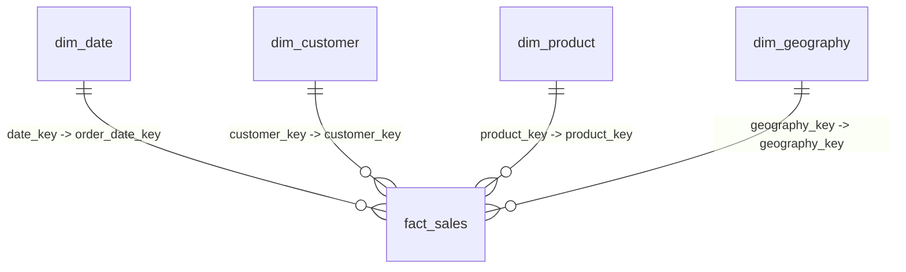

# Power BI Dashboard Blueprint & Visual Design Guide

This guide outlines the exact visual layout, color palette, data model relationships, and visual configurations for building the **4-Page Retail Sales Intelligence Dashboard** in Power BI Desktop.

---

## 1. Data Model Relationships (Star Schema)

Import the 5 files from `data/processed/` or connect directly to the MySQL database `retail_sales_dw`. Ensure **Single Direction (1 to Many)** relationships:

| From Table | From Column | To Table | To Column | Cardinality | Cross Filter |
|---|---|---|---|---|---|
| `dim_date` | `date_key` | `fact_sales` | `order_date_key` | 1 to Many (1:*) | Single |
| `dim_customer` | `customer_key` | `fact_sales` | `customer_key` | 1 to Many (1:*) | Single |
| `dim_product` | `product_key` | `fact_sales` | `product_key` | 1 to Many (1:*) | Single |
| `dim_geography` | `geography_key` | `fact_sales` | `geography_key` | 1 to Many (1:*) | Single |

---

## 2. Global Design System & Theme

* **Background**: Light Gray / Slate (`#F4F6F9`)
* **Card & Container Fill**: Pure White (`#FFFFFF`) with subtle border shadow (`#E2E8F0`, 1px solid)
* **Primary Brand Accent**: Deep Executive Navy (`#0F172A`)
* **Success / Positive KPI**: Emerald Green (`#10B981`)
* **Alert / Negative Loss**: Crimson Coral (`#EF4444`)
* **Secondary Accents**: Royal Blue (`#2563EB`), Amber Gold (`#F59E0B`), Violet (`#8B5CF6`)
* **Typography**: Segoe UI / Segoe UI Semibold

---

## 3. Four Dashboard Pages Breakdown

### Page 1: Executive Overview
*Target Audience: C-Suite, VP of Sales, Chief Commercial Officer*

* **Header & Global Slicers**:
  * Date Hierarchy Slider (`Year`, `Quarter`, `Month`)
  * Region Dropdown (`All`, `West`, `East`, `Central`, `South`)
* **Top KPI Band (4 Modern New Card Visuals)**:
  1. **Total Revenue**: Metric `$2.30M` | Subtitle `▲ +20.3% YoY`
  2. **Total Net Profit**: Metric `$287.8K` | Subtitle `Margin: 12.5%`
  3. **Total Orders**: Metric `5,009` | Subtitle `Avg Order Value: $460`
  4. **Active Customers**: Metric `794` | Subtitle `Repeat Rate: 98.1%`
* **Visual 1 (Area / Line Combo Chart)**: Monthly Sales & Profit Trend over Time (`dim_date[year_month]` on X-axis, `[Total Sales]` on Y-axis, `[Total Profit]` on secondary Y-axis).
* **Visual 2 (Clustered Bar Chart with Top Details)**: Revenue by Category (`Technology`, `Furniture`, `Office Supplies`) with Profit Margin % annotated on top of bars.
* **Visual 3 (Donut Chart)**: Revenue Breakdown by Customer Segment (`Consumer` ~50.6%, `Corporate` ~30.7%, `Home Office` ~18.7%).
* **Visual 4 (Gauge / Radial KPI)**: On-Time Delivery Rate (`59.5%` on-time vs `< 4 days` target).

---

### Page 2: Regional & Geospatial Analysis
*Target Audience: Regional Directors, Logistics & Territory Managers*

* **Header & Slicers**: Region Selector Buttons, State Hierarchy Search.
* **Top KPI Band**:
  * Best Performing Region (`West: $733.1K Sales, $109.9K Profit`)
  * Lowest Margin Region (`Central: 7.9% Margin Warning`)
  * Delayed Shipment Rate (`40.2% Delayed Shipments`)
* **Visual 1 (Filled Map / Shape Map)**: US State Revenue Heatmap (Choropleth map with color gradient from light blue to deep navy based on `[Total Sales]`).
* **Visual 2 (Horizontal Stacked Bar Chart)**: Top 10 States by Revenue (California, New York, Texas, Washington, Pennsylvania).
* **Visual 3 (Matrix Visual with Conditional Formatting)**: Region > State > City Performance Table:
  * Columns: `Total Orders`, `Sales`, `Profit`, `Profit Margin %` (Green if > 15%, Yellow if 5-15%, Red if < 0%).
* **Visual 4 (Scatter Plot / Bubble Chart)**: Regional Discount vs Profitability:
  * X-axis: `Average Discount %`
  * Y-axis: `Profit Margin %`
  * Bubble Size: `Total Sales`
  * Legend: `Region`

---

### Page 3: Customer Analytics & Retention
*Target Audience: Chief Marketing Officer, CRM & Retention Leads*

* **Header & Slicers**: Customer Segment, Order Frequency Filter.
* **Top KPI Band**:
  * Total Customer Base (`794 Customers`)
  * Repeat Buyer Rate (`98.1% Repeat Retention`)
  * Average Revenue Per User (ARPU) (`$2,902.83`)
  * Average Order Value (AOV) (`$460.14`)
* **Visual 1 (Treemap)**: Customer Value Tiers:
  * `Platinum VIP ($5,000+)`
  * `Gold ($2,500 - $4,999)`
  * `Silver ($1,000 - $2,499)`
  * `Bronze (< $1,000)`
* **Visual 2 (Scatter Plot - RFM Value Analysis)**:
  * X-axis: `Lifetime Orders`
  * Y-axis: `Lifetime Spend`
  * Bubble Size: `Lifetime Profit`
  * Tooltip: `Customer Name`, `Segment`, `Latest Purchase Date`
* **Visual 3 (Stacked Column Chart)**: Cohort Acquisition: New vs Returning Customer Sales Contribution by Year (2014 to 2017).
* **Visual 4 (Table Visual - Top 20 VIP Accounts)**:
  * Columns: `Rank`, `Customer Name`, `Segment`, `Region`, `Orders`, `Total Spend`, `Total Profit`.

---

### Page 4: Product Analytics & Profitability
*Target Audience: Inventory Managers, Merchandising & Product Leads*

* **Header & Slicers**: Category Multi-select, Subcategory Dropdown, Profitability Toggle (`All`, `Profitable Only`, `Loss-Making Only`).
* **Top KPI Band**:
  * Total Catalog SKUs (`1,863 Products`)
  * Top Selling SKU (`Canon imageCLASS 2200 Advanced Copier: $61.6K`)
  * Unprofitable Orders (`1,871 transactions with negative profit`)
* **Visual 1 (Decomposition Tree / Waterfall)**: Category -> Sub-Category -> Product Revenue Breakdown.
* **Visual 2 (Tornado / Diverging Bar Chart)**: Profit by Sub-Category:
  * Positive Bars: Copiers, Phones, Accessories, Paper, Binders.
  * Negative / Loss Bars: Tables (-$17.7K loss!), Bookcases, Supplies.
* **Visual 3 (Pareto 80/20 Chart - Line & Clustered Column)**:
  * Bars: Product Revenue in descending order.
  * Line: Cumulative % of Total Sales (showing the 80% cutoff line).
* **Visual 4 (Loss-Leader Warning Grid - Table)**:
  * High-risk products where discount > 30% led to negative margins.
  * Columns: `Product Name`, `Sub-Category`, `Avg Discount`, `Sales`, `Net Loss ($)`.
